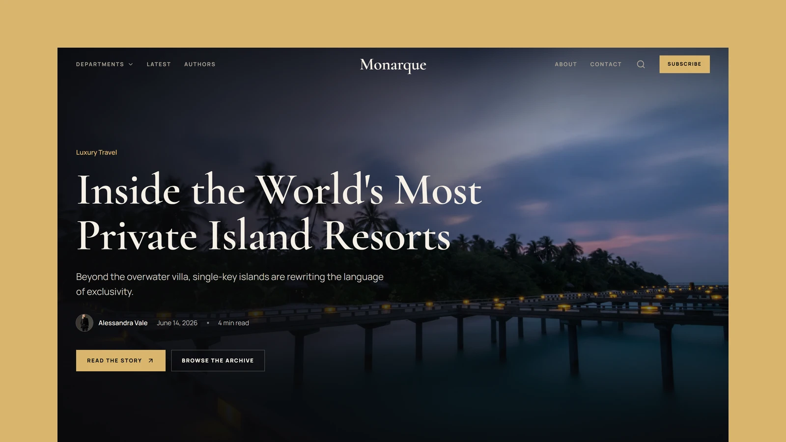

# Monarque - Astro Luxury Editorial Theme

[](https://monarque.xocoweb.workers.dev/)

[](https://astro.build/)
[](https://tailwindcss.com/)
[](https://mdxjs.com/)
[](https://www.typescriptlang.org/)
[](./LICENSE)

**Live preview:** https://monarque.xocoweb.workers.dev/

Monarque is a dark, square-edged Astro theme for luxury magazines, travel journals, and editorial brands. It pairs full-bleed photography and Cormorant display type with a quiet gold accent, and ships as static HTML with no framework runtime.

## Features

- Full-height cover story hero with a most-read strip, followed by the latest dispatches, department tiles, a spotlight story, and editor's picks
- Posts in Markdown or MDX, each in its own folder with colocated images
- Justified photo galleries: rows of equal height that keep every photo's proportions, placed after the article or anywhere in an MDX post with `<Gallery />`
- Gallery lightbox with keyboard and swipe navigation and a credit link for every photo
- Share sheet at the end of every article, with the phone's own share sheet used where available
- Sticky article contents that follow the section being read
- Author byline at the top of every article and an author card at the end
- Newsletter sign-up in the footer, provider-neutral and configured in one place
- Departments megamenu that opens full screen on mobile, and a search dialog backed by a lazily loaded static index
- Paginated blog, category, and tag archives on crawlable static URLs
- Author profiles listing every story by that writer
- Dark-only, square design system built on Tailwind CSS 4 tokens
- Responsive Astro images through Sharp, with alt text and dimensions on every image
- Self-hosted Manrope and Cormorant Garamond fonts, with local Lucide and Bootstrap SVG icons
- Canonical URLs, sitemap, RSS, Open Graph, Twitter/X cards, and Article JSON-LD
- Accessible skip link, landmarks, visible focus states, keyboard-operable dialogs, and reduced-motion support
- Centralized site, homepage, navigation, form, social, and pagination settings

## Tech Stack

- Astro 7 with MDX
- Tailwind CSS 4 via `@tailwindcss/vite`
- Vite 8, TypeScript, Astro content collections
- `@astrojs/sitemap`, `@astrojs/rss`, `@astrojs/markdown-remark` with `rehype-slug`, `github-slugger`, Sharp

## Requirements

- Node.js `22.12.0` or newer
- npm

## Getting Started

```bash
npm install
npm run dev
```

Build for production:

```bash
npm run build
```

Preview the production build locally:

```bash
npm run preview
```

Before shipping a change, run type checking, the production build, the static link and metadata scan, and the formatter check together:

```bash
npm run release:check
```

## Customization

See [CUSTOMIZATION.md](./CUSTOMIZATION.md) for site settings, homepage copy, categories, post and author frontmatter, galleries, sharing, forms, design tokens, fonts, icons, routes, and the pre-launch checklist.

Set `siteConfig.siteUrl` in [src/config/site.ts](./src/config/site.ts) before building: canonical URLs, Open Graph images, the sitemap, RSS, and robots are all derived from it. The build is static, so any host that serves a directory works. [wrangler.jsonc](./wrangler.jsonc) is included for Cloudflare Workers, and Netlify, Vercel, and GitHub Pages need nothing beyond `npm run build`.

## Content

Posts live in [src/content/posts](./src/content/posts) and authors in [src/content/authors](./src/content/authors). Each entry is a folder with an `index.md` or `index.mdx` and its own images, validated by the schemas in [src/content.config.ts](./src/content.config.ts).

The bundled posts and authors are demo content, so replace them before launch. Demo photography comes from [Unsplash](https://unsplash.com/), and every image carries its photographer and source URL in the frontmatter that renders it.

## Support

See [SUPPORT.md](./SUPPORT.md) for what a license includes, and [CHANGELOG.md](./CHANGELOG.md) for release history.

## License

Commercial license. See [LICENSE](./LICENSE) for complete terms.
